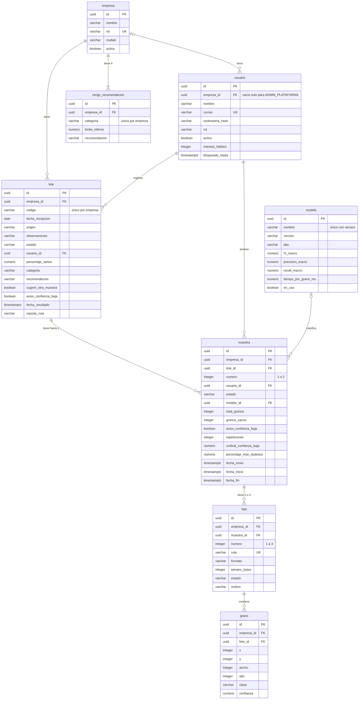

<!--
Nombre: modelo-datos.md
Descripción: Modelo de datos de InspectIA: diagrama entidad-relación, tablas con su trazabilidad a las fichas y decisiones de diseño.
Fecha de creación: 13/10/2026
Actualización: 13/10/2026
Autor: Equipo InspectIA
Versión: 1.1
-->

# Modelo de datos de InspectIA

Este documento explica las 8 tablas de InspectIA y de qué ficha sale cada atributo. La definición que usa el generador está en `specs/entidades/*.json` (formato en su README): si cambia un JSON, este documento se actualiza en el mismo PR.

## 1. Diagrama entidad-relación

Todas las tablas tienen además `fecha_creacion` y `fecha_actualizacion` (no se dibujan). `empresa_id` relaciona con `empresa` las tablas de cada empresa. El diagrama solo dibuja esas líneas para usuario, rango_recomendacion y lote, para que se pueda leer.

## 2. Columnas comunes

| Columna | Tipo | Dónde | Origen |
|---|---|---|---|
| `id` | uuid, llave primaria, `DEFAULT uuidv7()` | Todas | Convenciones técnicas (sección 5) |
| `fecha_creacion` | timestamptz, obligatoria | Todas | Pedido del equipo |
| `fecha_actualizacion` | timestamptz, obligatoria; la actualiza un trigger | Todas | Pedido del equipo |
| `empresa_id` | uuid, FK a empresa | Todas menos empresa y modelo. En usuario va vacía solo para ADMIN_PLATAFORMA | RNF-03 |

## 3. Tablas

En las tablas, «Oblig.» dice si el campo es obligatorio y «Único» si no se puede repetir. Las listas guardan códigos en mayúsculas; sus etiquetas en español e inglés están en los JSON.

### 3.1 empresa (CRUD generado)

| Atributo | Tipo | Oblig. | Único | Ficha |
|---|---|---|---|---|
| nombre | varchar(120) | Sí | — | RF-02 |
| nit | varchar(15), sin puntos y con dígito de verificación | Sí | Sí | RF-02, D-27 |
| ciudad | varchar(80) | Sí | — | RF-02 |
| activa | boolean, por defecto true | Sí | — | D-27, RF-01 |

- El administrador de la plataforma lista, ve, crea, edita, desactiva y reactiva empresas (RF-02, D-27). No se borran.
- Al crearla, el mismo formulario crea su primer administrador (`crear_con`) y la empresa recibe sus 4 rangos por defecto (RF-02).
- Con la empresa desactivada, sus usuarios no pueden entrar (RF-01). Al reactivarla, los usuarios activos vuelven a entrar.

### 3.2 usuario (CRUD generado)

| Atributo | Tipo | Oblig. | Único | Ficha |
|---|---|---|---|---|
| empresa_id | uuid, FK a empresa | Sí, salvo ADMIN_PLATAFORMA | — | RNF-03, RF-03 |
| nombre | varchar(120) | Sí | — | RF-02, RF-03 |
| correo | varchar(254), guardado en minúsculas | Sí | Sí, en toda la plataforma y sin distinguir mayúsculas | RF-01 a RF-03 |
| contrasena_hash | varchar(100), hash BCrypt | Sí | — | RF-01, RNF-04 |
| rol | lista: USUARIO_FINAL, ADMIN_EMPRESA, ADMIN_PLATAFORMA | Sí | — | RF-01, RF-03 |
| activo | boolean, por defecto true | Sí | — | RF-01, RF-03 |
| intentos_fallidos | integer, por defecto 0 | Sí | — | RF-01, RNF-04 |
| bloqueado_hasta | timestamptz | No | — | RF-01, RNF-04 |

- El administrador de empresa gestiona los usuarios de su empresa: listar, ver, crear, editar, desactivar y reactivar (RF-03). No se borran.
- El formulario solo ofrece los roles USUARIO_FINAL y ADMIN_EMPRESA. El backend rechaza cualquier otro, aunque llegue a mano a la API: responde «prohibido» (403, RNF-04) con un mensaje claro, sin esperar al CHECK de la base.
- Reglas (RF-03): máximo 25 usuarios activos por empresa. El administrador no puede desactivarse a sí mismo ni cambiar su propio rol, porque la empresa podría quedar sin administrador y el de la plataforma no edita usuarios.
- El administrador de la plataforma puede restablecer la contraseña de un administrador de empresa (RF-02).
- La contraseña se escribe en el formulario: de 8 a 64 caracteres y como máximo 72 bytes. Se guarda solo su hash (RF-02, RF-03).
- Un CHECK exige que `empresa_id` vaya vacía si y solo si el rol es ADMIN_PLATAFORMA (RNF-03).

### 3.3 rango_recomendacion (CRUD generado: editar y restaurar)

| Atributo | Tipo | Oblig. | Único | Ficha |
|---|---|---|---|---|
| empresa_id | uuid, FK a empresa | Sí | — | RNF-03 |
| categoria | lista: PREMIUM, ESTANDAR, CORRIENTE, FUERA_DE_NORMA | Sí | Única por empresa | RF-12, RF-13 |
| limite_inferior | numeric(4,1), de 0 a 100 | Sí | — | RF-12, RF-13 |
| recomendacion | varchar(300) | Sí | — | RF-12, RF-13 |

- Cada empresa tiene siempre 4 filas, que se crean con los valores de A.3 al registrarla (RF-02). «Restaurar valores por defecto» vuelve a ellos (RF-13).
- El administrador de empresa edita las 4 filas juntas. Fuera de norma queda fijo en 0 % (CHECK), y el backend valida que los límites bajen en orden (RF-13).

| Categoría | Límite inferior | Recomendación por defecto (A.3) |
|---|---|---|
| Premium o Especial | 96,0 % | Apto para mercado especial o de exportación. |
| Estándar | 90,0 % | Apto para venta estándar. Retirar a mano los granos defectuosos podría subirlo de categoría. |
| Corriente | 82,0 % | Retirar los granos defectuosos antes de vender, y revisar la fermentación y el secado. |
| Fuera de norma | 0,0 % | No venderlo como cacao de calidad: hacer una selección completa y revisar todo el proceso después de la cosecha. |

### 3.4 lote

| Atributo | Tipo | Oblig. | Único | Ficha |
|---|---|---|---|---|
| empresa_id | uuid, FK a empresa | Sí | — | RNF-03, RF-04 |
| codigo | varchar(30) | Sí | Único por empresa, sin distinguir mayúsculas ni espacios | RF-04 |
| fecha_recepcion | date, no posterior a hoy | Sí | — | RF-04 |
| origen | varchar(120): finca o proveedor | Sí | — | RF-04, RF-16 |
| observaciones | varchar(500) | No | — | RF-04 |
| estado | lista: PENDIENTE, ANALIZADO | Sí | — | RF-04, RF-12, RF-14 |
| usuario_id | uuid, FK a usuario (quién lo registró) | Sí | — | RF-04 |
| porcentaje_sanos | numeric(4,1) | Con resultado | — | RF-10, D-25 |
| categoria | lista de rango_recomendacion | Con resultado | — | RF-12, RF-13 |
| recomendacion | varchar(300), copia del texto del rango | Con resultado | — | RF-12, RF-13 |
| sugerir_otra_muestra | boolean | Con resultado | — | RF-12, D-24, D-25 |
| aviso_confianza_baja | boolean | Con resultado | — | RF-09, D-25 |
| fecha_resultado | timestamptz | Con resultado | — | RF-14 a RF-16 |
| reporte_ruta | varchar(255), llave del PDF en S3 | No | — | RF-15, D-25 |

- «Con resultado»: obligatorio cuando el estado es ANALIZADO y vacío cuando es PENDIENTE (CHECK).
- El resultado es del lote. Con 2 muestras sale de la suma de sus granos (D-25).
- Cuando termina la segunda muestra, el resultado se recalcula con los rangos vigentes y el PDF anterior se borra, para rehacerlo (RF-15).

### 3.5 muestra

| Atributo | Tipo | Oblig. | Único | Ficha |
|---|---|---|---|---|
| empresa_id | uuid, FK a empresa | Sí | — | RNF-03 |
| lote_id | uuid, FK a lote | Sí | Único junto con numero | RF-10, D-25 |
| numero | integer, 1 o 2 | Sí | (con lote_id) | D-25 |
| usuario_id | uuid, FK a usuario (quién la hizo) | Sí | — | RF-14, RF-15 |
| estado | lista: PENDIENTE, EN_ESPERA, EN_PROCESO, TERMINADA | Sí | — | RF-12, RF-14, RNF-02 |
| modelo_id | uuid, FK a modelo | Al terminar | — | RF-08, RF-15 |
| total_granos | integer, mínimo 100 y sin máximo | Al terminar | — | RF-07, RF-10, D-26 |
| granos_sanos | integer, no más que el total | Al terminar | — | RF-10 |
| aviso_confianza_baja | boolean | Al terminar | — | RF-09, D-25 |
| repeticiones | integer, de 0 a 2, por defecto 0 | Sí | — | RF-09 |
| umbral_confianza_baja | numeric(5,2), copia del parámetro | Al terminar | — | RF-09, P-15 |
| porcentaje_max_dudosos | numeric(4,1), copia del parámetro | Al terminar | — | RF-09, P-15 |
| fecha_envio | timestamptz | Desde EN_ESPERA | — | RNF-01, RNF-02 |
| fecha_inicio | timestamptz | Desde EN_PROCESO | — | RNF-02 |
| fecha_fin | timestamptz | Al terminar | — | RNF-01 |

- «Al terminar»: obligatorio cuando el estado es TERMINADA (CHECK).
- Una muestra pasa de PENDIENTE (captura de fotos) a EN_ESPERA cuando el usuario envía las fotos, a EN_PROCESO cuando el servidor la atiende y a TERMINADA con el resultado. Si hay que repetir una foto (RF-06, RF-07, RF-09) o el servicio de IA no responde (RF-08), vuelve a PENDIENTE sin guardar un resultado incompleto.
- La segunda muestra solo se crea si el lote tiene `sugerir_otra_muestra` y una sola muestra (D-25).

### 3.6 foto

| Atributo | Tipo | Oblig. | Único | Ficha |
|---|---|---|---|---|
| empresa_id | uuid, FK a empresa | Sí | — | RNF-03 |
| muestra_id | uuid, FK a muestra | Sí | — | RF-05, D-25 |
| numero | integer, de 1 a 3 | Sí | Único por muestra | RF-05, RF-09 |
| ruta | varchar(255), llave en S3 | Sí | Sí | RF-05, D-16 |
| formato | lista: JPG, PNG | Sí | — | RF-05 |
| tamano_bytes | integer, hasta 10 MB (10.485.760 bytes) | Sí | — | RF-05 |
| estado | lista: CARGADA, APROBADA, POR_REPETIR | Sí | — | RF-06, RF-07, RF-09 |
| motivo | lista: BORROSA, POCA_LUZ, GRANOS_PEGADOS, GRANOS_DUDOSOS | Solo si POR_REPETIR | — | RF-06, RF-07, RF-09 |

- Cuando llega la foto nueva, la rechazada o reemplazada se borra de la base y de S3, con sus granos. La nueva toma su mismo número (RF-05, RF-09).

### 3.7 grano

| Atributo | Tipo | Oblig. | Único | Ficha |
|---|---|---|---|---|
| empresa_id | uuid, FK a empresa | Sí | — | RNF-03 |
| foto_id | uuid, FK a foto; se borra con la foto | Sí | — | RF-07, RF-05 |
| x, y | integer, desde 0 | Sí | — | RF-07, RF-11 |
| ancho, alto | integer, desde 1 | Sí | — | RF-07, RF-11 |
| clase | lista: SANO, NO_SANO | Sí | — | RF-08, RF-11 |
| confianza | numeric(5,2), de 0 a 100 | Sí | — | RF-08, RF-09, RF-17 |

- «Dudoso» no se guarda: un grano es dudoso si su confianza es menor que el `umbral_confianza_baja` copiado en su muestra (RF-09, RF-11).
- La confianza promedio de RF-17 se calcula con estos granos.

### 3.8 modelo (común a todas las empresas)

| Atributo | Tipo | Oblig. | Único | Ficha |
|---|---|---|---|---|
| nombre | varchar(80) | Sí | Único junto con version | RF-08, RF-17 |
| version | varchar(20) | Sí | (con nombre) | RF-08, RF-17 |
| tipo | lista: CNN, TRANSFORMER | No¹ | — | D-18, RP-25 |
| f1_macro | numeric(5,2), de 0 a 100 | No¹ | — | RF-17, RNF-07 |
| precision_macro | numeric(5,2), de 0 a 100 | No¹ | — | RF-17, RNF-07 |
| recall_macro | numeric(5,2), de 0 a 100 | No¹ | — | RF-17, RNF-07 |
| tiempo_por_grano_ms | numeric(8,2) | No¹ | — | D-18 |
| en_uso | boolean, por defecto false | Sí | Solo uno en true | RF-17, D-18 |

¹ Vacíos solo en el clasificador falso de desarrollo. Un CHECK exige que estén todos o ninguno.

- La tabla guarda la comparación de D-18 (RP-25). El script de base de datos (RP-15) carga los 5 modelos de Julián y marca en uso el elegido, que es el mismo que carga el servicio de IA.
- Mientras llegan los modelos (P-01), el script de datos de desarrollo carga solo el clasificador falso.

## 4. Relaciones y borrado

| Relación | Cardinalidad | Al borrar el padre | Ficha |
|---|---|---|---|
| empresa → usuario | 1 a muchos (el usuario puede no tener empresa si es ADMIN_PLATAFORMA) | Restringir | RF-02, RF-03, RNF-03 |
| empresa → rango_recomendacion | 1 a 4 | Restringir | RF-02, RF-13 |
| empresa → lote | 1 a muchos | Restringir | RF-04, RNF-03 |
| usuario → lote | 1 a muchos (quién lo registró) | Restringir | RF-04 |
| lote → muestra | 1 a 0, 1 o 2 | Restringir | D-25 |
| usuario → muestra | 1 a muchos (quién la hizo) | Restringir | RF-14 |
| modelo → muestra | 1 a muchos (vacío hasta terminar) | Restringir | RF-08 |
| muestra → foto | 1 a 2 o 3 | Restringir | RF-05 |
| foto → grano | 1 a muchos | Cascada | RF-07, RF-05 |

- En InspectIA no se borran empresas, usuarios, lotes ni muestras (RF-03, D-27). Solo se borran las fotos rechazadas o reemplazadas, y sus granos con ellas.
- Si las dos tablas de una relación tienen `empresa_id`, la FK es compuesta (`hijo.padre_id, hijo.empresa_id` → `padre.id, padre.empresa_id`). Así un registro no puede apuntar a otro de una empresa distinta (RNF-03).

## 5. Decisiones de diseño

### Respuestas del equipo (13/10/2026)

| Tema | Decisión |
|---|---|
| Muestras del lote | Hasta 2 muestras por lote. El resultado (porcentaje, categoría, recomendación, sugerencia, aviso, fecha y PDF) es del lote; cada muestra guarda sus conteos, su modelo, sus repeticiones y la copia de los parámetros (D-25). |
| Nombre de la tabla | `muestra`, no `analisis`: así queda lote → muestra → foto → grano. El módulo del backend sigue llamándose `analisis` (D-21). |
| Administrador de la plataforma | No tiene empresa: `empresa_id` vacío solo para ADMIN_PLATAFORMA, con un CHECK en la base. La tabla `modelo` es la otra excepción de RNF-03. |
| Finca o proveedor | Texto libre, comparado sin distinguir mayúsculas ni espacios (índice sobre `lower(btrim(origen))`), con sugerencias de los valores ya usados (RF-04, RF-16). |
| 10 % y umbral de confianza baja | Parámetros del sistema en `application.yml` del backend, no en la base. Cada muestra guarda una copia de los valores que usó, para que sus granos dudosos no cambien si se ajustan (RF-09, P-15). |
| Fotos rechazadas o reemplazadas | Se borran de la base y de S3, con sus granos. La muestra guarda cuántas repeticiones hubo (RF-09). |
| Texto de la recomendación | Un solo texto por rango, el que escribe la empresa, sin traducción. Los nombres de las categorías van en español e inglés (RP-11). |
| Longitudes | Las de las tablas de la sección 3. |
| NIT | Sin puntos y con dígito de verificación: `^[0-9]{6,10}-[0-9]$` (por ejemplo, 900123456-8). El backend valida el dígito con el algoritmo de la DIAN (ver abajo). |
| Código del lote | Único en la empresa, sin distinguir mayúsculas ni espacios al inicio o al final: índice único sobre `(empresa_id, lower(btrim(codigo)))`. |
| Contraseña | De 8 a 64 caracteres y como máximo 72 bytes, porque BCrypt solo usa 72. Spring Security rechaza las contraseñas nuevas de más de 72 bytes. Mensaje: «La contraseña es demasiado larga: usa menos caracteres o menos tildes y eñes». |
| Más de 150 granos | Se aceptan; el mínimo de 100 es obligatorio (D-26). |
| Empresas | Se pueden editar (con las validaciones del registro), desactivar y reactivar; no se borran (D-27). |

**Dígito de verificación del NIT (DIAN):**
1. Se multiplica cada dígito del NIT, empezando por la derecha, por 3, 7, 13, 17, 19, 23, 29, 37, 41, 43, 47, 53, 59, 67 y 71.
2. Se suman los productos y se calcula el residuo de dividir la suma por 11.
3. Si el residuo es 0 o 1, ese es el dígito; si no, el dígito es 11 menos el residuo.

Ejemplos verificados: 890903938-8 y 899999068-1.

### Convenciones técnicas

| Tema | Decisión |
|---|---|
| Identificadores | UUID v7, generados por PostgreSQL 18 con `uuidv7()`. Una empresa no puede adivinar los de otra ni deducir cuántos lotes hay en la plataforma (RNF-03). |
| Listas de valores | Texto (`varchar(30)`) con CHECK, no enum de PostgreSQL: se cambian desde los JSON sin migraciones especiales. |
| Fechas | `timestamptz` para fecha y hora. «Hoy» (RF-04) se calcula con la hora de Colombia (America/Bogota). `fecha_actualizacion` la mantiene un trigger, así también cambia si un script modifica la tabla. |
| Enteros | `integer` en lugar de `smallint`, para que el generador use `Integer` en Java sin conversiones. |
| Porcentajes | De 0 a 100. El % de sanos y los límites llevan 1 decimal (RF-10, RF-13); la confianza y las métricas, 2. |
| Posición del grano | Rectángulo sin rotación (x, y, ancho, alto), en píxeles de la foto original. |
| Granos pegados | Sus regiones (RF-07) no se guardan: se muestran en el momento para repetir la foto. |
| Copias en el resultado | El lote guarda la categoría y el texto de la recomendación, y cada muestra su modelo y los parámetros. Si cambian los rangos (RF-13) o los parámetros, los resultados anteriores no cambian (RF-15). |
| Aviso de confianza baja | Va en cada muestra y en el lote; el del lote es verdadero si alguna muestra lo tiene (D-25). |
| Fechas de la muestra | `fecha_envio`, `fecha_inicio` y `fecha_fin` miden el tiempo de respuesta (RNF-01) y la espera en cola (RNF-02) con datos reales. Si la muestra se reenvía, guardan el último envío. |
| PDF del lote | Se crea en la primera descarga y después se reutiliza; se borra y se rehace cuando termina la segunda muestra (RF-15, D-25). |
| Consistencia por estado | Varios CHECK usan `num_nonnulls()` para exigir los campos de cada estado: lote ANALIZADO, muestra TERMINADA y modelo completo. |
| Empresa en cada tabla | FK compuestas con `empresa_id`, para que la base impida mezclar empresas (RNF-03). |
| Datos iniciales | El script de base de datos (RP-15) crea el primer administrador de la plataforma, con la contraseña tomada de una variable de entorno y nunca del repositorio (RF-01), y carga los modelos. Los rangos por defecto están en `rango_recomendacion.json`. |

## 6. Qué no tiene tabla

| Dato | Dónde está |
|---|---|
| Categorías | Lista fija de 4 en `rango_recomendacion.categoria` (RF-13) |
| 10 % y umbral de confianza baja | `application.yml` del backend, con copia en cada muestra (P-15) |
| Estadísticas y confianza promedio | Consultas sobre lote, muestra y grano (RF-16, RF-17) |
| Sesión | JWT de 8 horas (RF-01, RNF-04) |
| Cita del dataset («Acerca de») | Texto fijo de la página web (RNF-08) |
| Regiones de granos pegados | Respuesta del servicio de IA en el momento (RF-07) |
